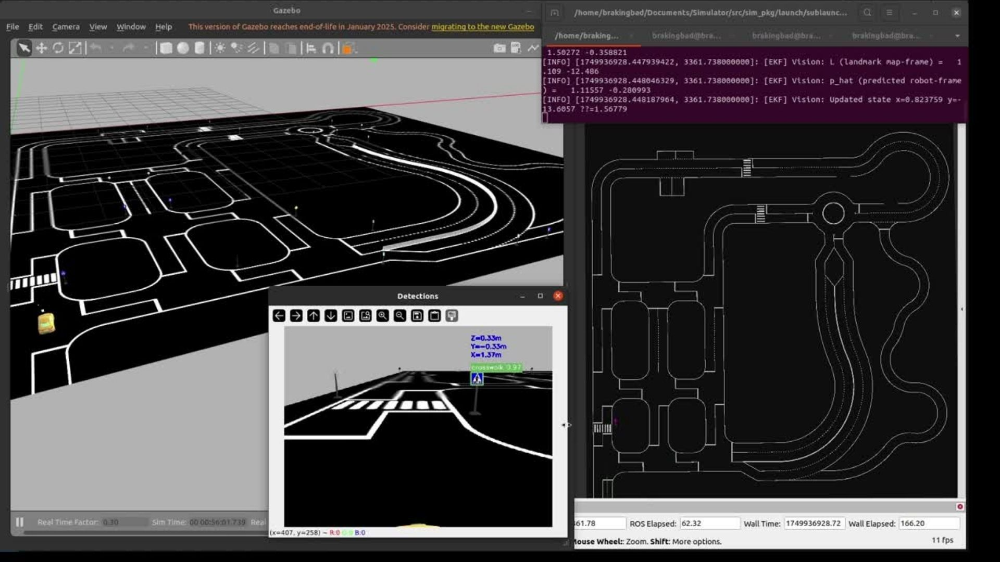

# Vision-Aided Vehicle Localization

A bachelor's thesis project that estimates an Ackermann vehicle's position by combining traffic sign observations, wheel odometry, and inertial measurements in a ROS/Gazebo simulation.

**Dimitrios Asimakopoulos · University of Crete, Computer Science · June 2025**<br>
**CVRL, FORTH · Supervisor: Prof. Panos Trahanias**

[](docs/thesis/presentation.pdf#page=20)

*Gazebo, sign pose estimation, and RViz during the thesis demonstration. Original presentation, slide 20.*

**C++ · Python · ROS Noetic · Gazebo 11 · Eigen · OpenCV · YOLOv5-Nano/PyTorch**

[Read the thesis](docs/thesis/report.pdf) · [View the presentation](docs/thesis/presentation.pdf) · [Setup](docs/SETUP.md) · [Architecture & results](docs/ARCHITECTURE.md) · [Demo](docs/media/README.md)

## From competition platform to thesis

This work grew from FORTH's **Braking Bad** team and the **Bosch Future Mobility Challenge (BFMC)**, where the team reached the semifinals. The thesis, *Pose Estimation via Visual Inertial Wheel Odometry in Autonomous Vehicles*, investigates how known traffic signs can correct the drift that accumulates when a vehicle relies on wheels and an inertial measurement unit (IMU).

The project packages perception, sensor plugins, and fusion as ROS components. Camera detections become sign positions in the vehicle frame. A custom extended Kalman filter (EKF), called **BB EKF** in the thesis, combines these observations with encoder velocity and IMU yaw. Recorded trajectories expose the effect of landmark corrections and support offline analysis.

## My contribution

- Prepared an annotated eight-class traffic-sign dataset and integrated YOLOv5-Nano with contour-based Perspective-n-Point geometry and a pinhole fallback.
- Connected camera calibration, coordinate transformations, and temporal filtering to publish sign observations in the vehicle frame.
- Developed a five-state C++ EKF with class-constrained landmark association and Mahalanobis gating for vision updates.
- Implemented Ackermann wheel odometry as a Gazebo plugin using wheel rotation and steering geometry.
- Built sensor characterization and trajectory evaluation tools, connecting covariance choices to residual statistics and localization error.

The fork retains the inherited BFMC simulator, its history, and original attribution. Braking Bad's semifinal placement is a team achievement. The thesis evaluates this localization stack in simulation, with physical vehicle deployment identified as future work.

## System at a glance


[Open the full diagram](docs/images/architecture.svg) · [Editable source](docs/images/architecture.dot)

The filter estimates `[x, y, yaw, speed, yaw rate]` against a **known landmark map**. Ground truth supplies a one-time initial pose and the evaluation reference. Sign updates add positional anchors between motion measurements. The implementation focuses on known-map localization.

| Technology | Role |
|---|---|
| ROS Noetic / Catkin | Nodes, messages, transforms, and C++ builds |
| Gazebo 11 / SDF | Vehicle dynamics, track, camera, and sensor plugins |
| C++ / Eigen | EKF prediction, measurement updates, and covariance algebra |
| Python / OpenCV / PyTorch | YOLOv5-Nano integration, sign geometry, and ROS perception |
| LabelImg | Manual traffic-sign bounding-box annotations |
| NumPy / pandas / Matplotlib / rosbag | Sensor residuals, timestamp alignment, metrics, and plots |

## Evidence from the thesis

[](docs/thesis/report.pdf#page=55)

*Original thesis, Figure 15. Trajectories are shown relative to their starting positions.*

Chapter 9 reports position RMSE of **0.4658 m** for BB EKF versus **0.5505 m** for its encoder/IMU comparison, with slightly higher yaw RMSE (**0.6129 rad** versus **0.6016 rad**). The repository CSV below records a separate experiment. The checked-out comparison filter uses deliberately inflated noise settings. Read the [experiment and tuning context](docs/ARCHITECTURE.md#experimental-evidence) when interpreting either result set.

## Explore the implementation

- [Sign pose estimation](src/example/src/sign_detector_node.py): image detections, geometric pose estimation, and vehicle-frame observations.
- [Vision-aided EKF](src/example/src/ekf_fusion_node.cpp): motion prediction, landmark matching, and fused ROS outputs.
- [Wheel encoder plugin](src/plugins_pkgs/wheel_encoder_plugin/src/wheel_encoder_plugin.cpp): Ackermann odometry integration.
- [Characterization](src/example/src/characterize_sensors.py) and [evaluation](src/example/src/evaluation.py): the experimental workflow.

## Inspect the archived CSV

From the repository root, this dependency-free command reads the saved summary:

```bash
python3 - <<'PY'
import csv
from pathlib import Path
path = Path('src/example/src/evaluation_plots/ekf_comparison_metrics.csv')
for row in csv.DictReader(path.open()):
    print(f"{row['method']}: position RMSE {float(row['pos_rmse']):.3f} m")
PY
```

It prints **0.320 m** and **0.503 m** for the archived CSV run. For simulation, follow the [setup guide](docs/SETUP.md). Trained weights and the original experiment rosbags are not included.

## Demo and original materials

[Thesis PDF, presentation, and original slide archive](docs/thesis/README.md) · [Existing simulation recording](docs/media/simulation-signs.mp4)

<!-- DEMO_UPLOAD_SLOT: replace this paragraph with the video poster/link after uploading docs/media/demo.mp4. -->
**Final thesis demo:** upload `demo.mp4` using the [reserved demo slot](docs/media/README.md#upload-the-final-demo).
<!-- END_DEMO_UPLOAD_SLOT -->

[Original BFMC license](LICENSE) · [Attribution and organization](docs/ARCHITECTURE.md#provenance-and-organization) · [Validation record](docs/VALIDATION.md)
