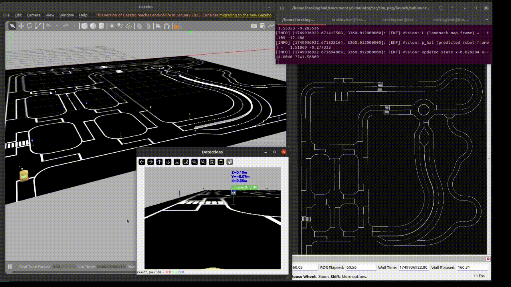
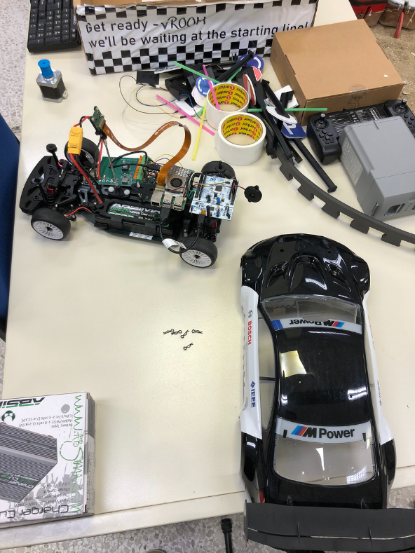
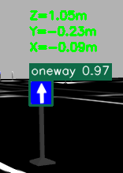
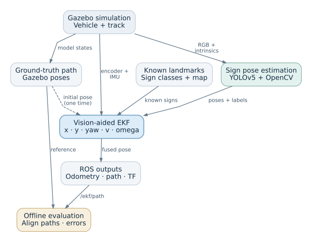
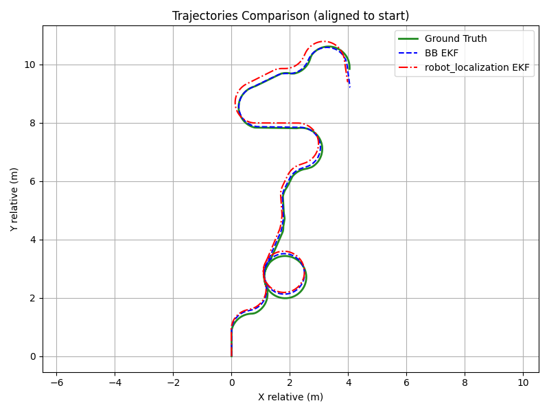

# Traffic Sign–Aided Vehicle Localization

Estimate an autonomous vehicle's position by combining traffic-sign observations, wheel odometry, and inertial measurements in a ROS/Gazebo simulation.

[Report](docs/thesis/report.pdf) · [Presentation](docs/thesis/presentation.pdf) · [Setup](docs/SETUP.md) · [Architecture & results](docs/ARCHITECTURE.md) · [Download full video](https://github.com/mitsosasim/Simulator/raw/refs/heads/main/docs/media/demo.mp4)

**C++ · Python · ROS Noetic · Gazebo 11 · Eigen · OpenCV · YOLOv5-Nano/PyTorch**

Wheel and inertial measurements drift over time. This project uses known traffic signs as landmarks to correct that drift: a camera detects a sign, geometry estimates its position relative to the car, and an extended Kalman filter (EKF) combines the observation with motion measurements.

The work grew from FORTH's **Braking Bad** team and the **Bosch Future Mobility Challenge**, where the team reached the semifinals.

## My contribution

- Manually annotated approximately 3,000 traffic-sign images and trained YOLOv5-Nano to detect eight sign classes.
- Integrated the trained detector with geometric sign pose estimation.
- Combined camera calibration, coordinate transforms, and temporal filtering to produce landmark observations in the vehicle frame.
- Developed a five-state C++ EKF with class-based landmark association and Mahalanobis gating to reject unlikely matches.
- Implemented Ackermann wheel odometry as a Gazebo plugin using wheel rotation and steering geometry.
- Built sensor characterization and trajectory evaluation tools to study noise, drift, and localization error.

<table>
  <tr>
    <td width="50%" align="center"> BFMC vehicle platform</td>
    <td width="50%" align="center"> Sign pose estimation in simulation</td>
  </tr>
</table>

## How it works

The filter estimates position, heading, speed, and yaw rate against a known landmark map. Ground truth supplies the initial pose and the evaluation reference.

ROS communication: topics and services

## Results

In the thesis's representative simulation run, sign-aided localization reduced position RMSE (root mean square error) by about **15%**, from **0.5505 m to 0.4658 m**. Yaw RMSE was slightly higher: **0.6129 rad versus 0.6016 rad**. The comparison uses a local encoder/IMU filter with different noise settings, so it does not isolate the effect of vision. See [experiment details](docs/ARCHITECTURE.md#results).

*Both filters follow the route; separation from ground truth shows position drift. [State and error plots](docs/ARCHITECTURE.md#state-tracking) show how it changes over time.*

## Explore the code

| Component | Implementation |
|---|---|
| Sign detection and pose estimation | [Python, OpenCV, and YOLOv5](src/example/src/sign_detector_node.py) |
| Vision-aided sensor fusion | [C++ EKF with Eigen](src/example/src/ekf_fusion_node.cpp) |
| Ackermann odometry | [Gazebo wheel encoder plugin](src/plugins_pkgs/wheel_encoder_plugin/src/wheel_encoder_plugin.cpp) |
| Experimental analysis | [Sensor characterization](src/example/src/characterize_sensors.py) and [trajectory evaluation](src/example/src/evaluation.py) |

**Dimitrios Asimakopoulos · Bachelor's thesis · University of Crete · June 2025** 
Computer Vision and Robotics Laboratory (CVRL), FORTH · Supervisor: Prof. Panos Trahanias

Follow the [setup guide](docs/SETUP.md) to build and run the simulator. It targets Ubuntu 20.04, ROS Noetic, and Gazebo 11. Trained weights and original experiment rosbags are not included. The thesis evaluates simulation; physical vehicle deployment is future work.

The project builds on the [BFMC simulator](LICENSE) and [YOLOv5](YOLOv5-traffic/yolov5/LICENSE).
