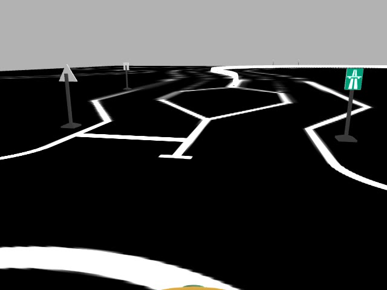
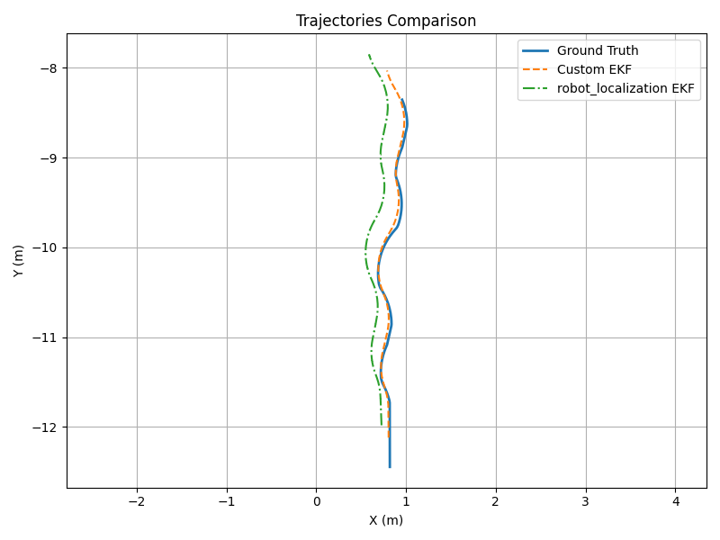

# Vision-Aided Vehicle Localization

A bachelor's thesis project that estimates an Ackermann vehicle's position by combining traffic sign observations, wheel odometry, and inertial measurements in a ROS/Gazebo simulation.

**Dimitrios Asimakopoulos · Computer Science BSc thesis · CVRL, FORTH · Supervisor: Prof. Trahanias**

<table>
  <tr>
    <td width="50%"><a href="docs/images/simulation-camera.png"></a></td>
    <td width="50%"><a href="src/example/src/evaluation_plots/trajectories.png"></a></td>
  </tr>
  <tr>
    <td><sub>Simulation camera frame from the repository's recording.</sub></td>
    <td><sub>Archived trajectory comparison. See the experimental qualifications below.</sub></td>
  </tr>
</table>

**C++ · Python · ROS Noetic · Gazebo 11 · Eigen · OpenCV · YOLOv5/PyTorch**

[Thesis & presentation](docs/thesis/README.md) · [Setup](docs/SETUP.md) · [Architecture & results](docs/ARCHITECTURE.md) · [Demo](docs/media/README.md)

## From competition platform to thesis

This work grew from FORTH's **Braking Bad** team and the **Bosch Future Mobility Challenge (BFMC)**, where the team reached the semifinals. The thesis focuses on perception and localization within that setting. This fork retains the competition simulator and its history while making the thesis contribution the entry point.

As the simulated car moves, camera images become labeled sign positions. A custom extended Kalman filter (EKF) combines these landmark observations with encoder velocity and IMU yaw to estimate the vehicle's pose. Recorded trajectories support comparison against simulator ground truth.

## My contribution

- Implemented traffic sign pose estimation using YOLOv5 detections, color and shape filtering, Perspective-n-Point geometry, and a pinhole fallback.
- Integrated camera calibration, coordinate transformations, and temporal filtering to publish sign observations in the vehicle frame.
- Developed a five-state C++ EKF with class-constrained landmark association and Mahalanobis gating for vision updates.
- Implemented Ackermann wheel odometry as a Gazebo plugin using wheel rotation and steering geometry.
- Built sensor characterization and offline trajectory evaluation tools, connecting covariance choices to measured residuals and localization error.

The inherited track, vehicle models, and competition utilities remain credited to their original authors. Vendored YOLOv5 retains its own license and notices. The team result above provides context for the work, rather than a claim that this thesis stack was the competition vehicle's deployed system.

## System at a glance


[Open the full diagram](docs/images/architecture.svg) · [Editable diagram source](docs/images/architecture.dot)

The filter estimates `[x, y, yaw, speed, yaw rate]` against a **known landmark map**. Ground truth supplies a one-time initial pose and the evaluation reference. This is localization in simulation, with no map-building claim.

| Technology | Role |
|---|---|
| ROS Noetic / Catkin | Nodes, messages, transforms, and C++ builds |
| Gazebo 11 / SDF | Vehicle dynamics, track, camera, and sensor plugins |
| C++ / Eigen | EKF prediction, measurement updates, and covariance algebra |
| Python / OpenCV / PyTorch | Detection, sign geometry, and ROS perception integration |
| NumPy / pandas / Matplotlib / rosbag | Sensor residuals, timestamp alignment, metrics, and plots |

## Explore the implementation

- [Sign pose estimation](src/example/src/sign_detector_node.py): the path from image detections to vehicle-frame observations.
- [Vision-aided EKF](src/example/src/ekf_fusion_node.cpp): motion prediction, landmark matching, and fused ROS outputs.
- [Wheel encoder plugin](src/plugins_pkgs/wheel_encoder_plugin/src/wheel_encoder_plugin.cpp): Ackermann odometry integration.
- [Characterization](src/example/src/characterize_sensors.py) and [evaluation](src/example/src/evaluation.py): the experimental workflow.

## Inspect the archived results

From the repository root, this dependency-free command reads the saved experiment summary:

```bash
python3 - <<'PY'
import csv
from pathlib import Path
path = Path('src/example/src/evaluation_plots/ekf_comparison_metrics.csv')
for row in csv.DictReader(path.open()):
    print(f"{row['method']}: position RMSE {float(row['pos_rmse']):.3f} m")
PY
```

The archived values are **0.320 m** for the vision-aided EKF and **0.503 m** for the local comparison filter. The latter deliberately uses inflated noise settings and is not the upstream `robot_localization` package. These figures describe the saved experiment, not a controlled benchmark or a newly reproduced run. [Interpretation and limitations](docs/ARCHITECTURE.md#experimental-evidence).

For simulation, follow the [Ubuntu 20.04 / ROS Noetic setup guide](docs/SETUP.md). Trained weights and the original experiment rosbag are not included.

## Demo

[View the existing simulation recording](docs/media/simulation-signs.mp4).

<!-- DEMO_UPLOAD_SLOT: replace this paragraph with the video poster/link after uploading docs/media/demo.mp4. -->
**Final thesis demo:** upload `demo.mp4` using the [reserved demo slot](docs/media/README.md#upload-the-final-demo). The final demo and original thesis materials are pending import.
<!-- END_DEMO_UPLOAD_SLOT -->

[Original BFMC license](LICENSE) · [Attribution and repository organization](docs/ARCHITECTURE.md#provenance-and-organization) · [Validation record](docs/VALIDATION.md)
