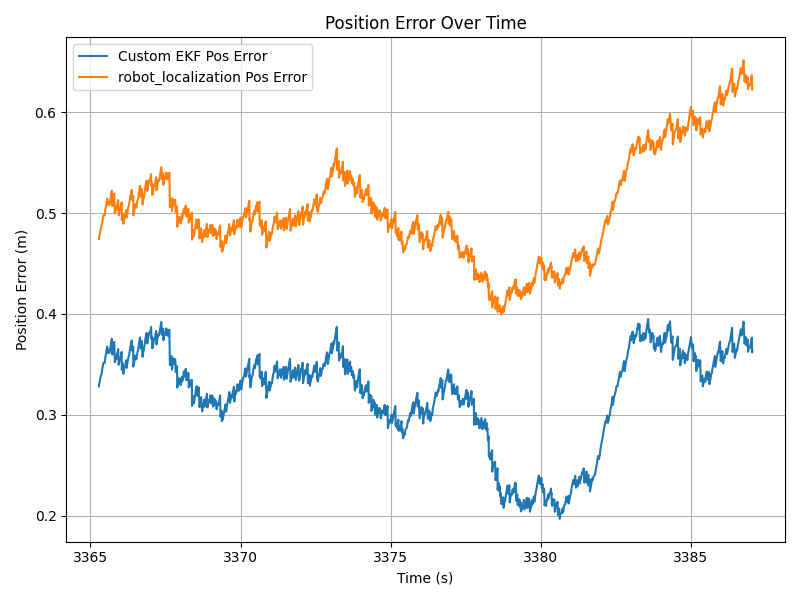

# Architecture and experimental evidence

[Project overview](../README.md) · [Setup](SETUP.md) · [Original thesis materials](thesis/README.md)

## Processing path


The diagram follows the active C++ fusion node and Python detector. The original [thesis](thesis/report.pdf) calls this system Visual-Inertial-Wheel Odometry (VIWO) and names the custom filter BB EKF, connecting it to Braking Bad. Its purpose is to correct accumulated dead-reckoning drift with intermittent observations of known signs. Its editable source is [architecture.dot](images/architecture.dot). Regenerate the SVG with:

```bash
dot -Tsvg docs/images/architecture.dot -o docs/images/architecture.svg
```

### Perception

[`sign_detector_node.py`](../src/example/src/sign_detector_node.py) subscribes to the car's image and camera calibration topics. It undistorts each image and runs the local YOLOv5 model. Within each detected region, color masks and shape checks select contours for sign geometry. Depending on shape, the node uses Perspective-n-Point (PnP), PnP with RANSAC, or geometric depth estimation. A pinhole calculation provides a fallback when PnP does not yield a translation.

Physical sign dimensions are expressed in centimeters, then estimated positions are converted to meters. TF transforms observations into `chassis::link`. A temporal distance check compares same-class observations against the previous accepted frame. The node publishes poses, labels, an annotated image, and sign transforms. It also opens an OpenCV display window, so CPU inference alone does not make the current node headless.

| Interface | Data |
|---|---|
| `/automobile/image_raw` | Camera image |
| `/automobile/camera_info` | Camera intrinsics and distortion coefficients |
| `/sign_detector/sign_poses` | `geometry_msgs/PoseArray` in `chassis::link` |
| `/sign_detector/sign_labels` | `utils_ros/SignLabelArray` |
| `/automobile/image_annotated` | Detection overlay |

### Dataset and model context

Chapter 4 of the [thesis](thesis/report.pdf#page=16) identifies YOLOv5-Nano as the lightweight detector and describes manual LabelImg annotation for eight classes: crosswalk, one-way, roundabout, no-entry, highway entry, parking, priority, and highway exit. The design combines a semantic class with known physical sign dimensions, turning an image detection into a metric landmark observation.

The report describes approximately 3,000 collected images, an 80/20 train–validation split, and 640 × 640 model inputs. The current checkout contains 573 training and 144 validation images under `YOLOv5-traffic/images/`. Those counts describe different evidence: the report's training account and the subset actually available here. No checkpoint or training run logs accompany the archive, so the documentation does not treat the complete reported training experiment as reproduced.

### Motion and sensor fusion

The [wheel encoder plugin](../src/plugins_pkgs/wheel_encoder_plugin/src/wheel_encoder_plugin.cpp) reads rear wheel and front steering joints, wheel radius, and wheelbase from SDF. It publishes linear velocity and yaw rate as ROS odometry. The [vehicle configuration](../src/models_pkg/rcCar_assembly_REC/model.sdf) requests 100 Hz publication. This is a configured rate, not a measured timing guarantee.

[`ekf_fusion_node.cpp`](../src/example/src/ekf_fusion_node.cpp) maintains the state `x = [x, y, yaw, v, omega]`. Wheel messages trigger motion prediction and velocity updates. IMU messages update yaw with angle wrapping. The BNO055-named Gazebo plugin supplies simulator orientation at a configured 10 Hz, rather than integrating physical accelerometer or gyroscope samples. The thesis identifies this idealized orientation and the absence of wheel slip as simulation assumptions. Vision updates compare a measured sign position with the predicted position of a known landmark in the vehicle frame.

Association searches only landmarks with the same class label. The implementation selects the smallest squared Mahalanobis distance using the configured vision covariance and rejects matches above `5.99`. The subsequent EKF correction uses its measurement Jacobian and state covariance. The association gate itself does not use the full innovation covariance.

Ground truth seeds the first pose once, after which that subscription is shut down. The node publishes `/ekf/odom`, `/ekf/path`, and the `map → chassis::link` transform. The fixed landmark coordinates are part of the source, so changing the world requires reviewing the landmark map.

### Comparison and evaluation

The active all-objects launch starts the repository's C++ executable named `robot_localization`. Despite that name, [`robot_localization.cpp`](../src/example/src/robot_localization.cpp) is a separate local five-state encoder/IMU filter. Its comments and constants explicitly inflate process and measurement noise. The separate [`robot_localization.py`](../src/example/src/robot_localization.py) integrates the external ROS package, but that node is commented out in the main launch.

[`ground_truth.py`](../src/example/src/ground_truth.py) converts Gazebo model states into a reference path. [`characterize_sensors.py`](../src/example/src/characterize_sensors.py) interpolates the reference trajectory, calculates encoder and yaw residuals, and reports filtered standard deviations and suggested measurement variances on shutdown.

[`evaluation.py`](../src/example/src/evaluation.py) extracts the latest pose from each recorded path message, sorts and deduplicates timestamps, and aligns estimates to reference timestamps with a nearest-neighbor tolerance of 0.05 seconds. Position error is the Euclidean **3D** distance, even though filter motion is planar. Yaw error is the absolute wrapped angular difference. It saves RMSE, mean and maximum errors, trajectory plots, time series, histograms, and cumulative distributions.

## Experimental evidence

### Representative run reported in the thesis

Chapter 9, section 9.3 of the [original report](thesis/report.pdf#page=54) records the following simulation results. The presentation shows the corresponding trajectory and error plots. They are historical report values, not a new execution of the current checkout.

| Reported method | Position RMSE (m) | Position mean (m) | Yaw RMSE (rad) | Yaw mean (rad) |
|---|---:|---:|---:|---:|
| BB EKF with sign updates | 0.4658 | 0.4456 | 0.6129 | 0.5115 |
| Local encoder/IMU comparison | 0.5505 | 0.5181 | 0.6016 | 0.5042 |

The thesis reports approximately 15% lower position RMSE and slightly higher yaw RMSE for this representative run. It also reports maximum BB EKF errors of 0.6734 m and 1.1775 rad. The heading tradeoff is part of the result and should accompany any discussion of positional improvement.


*Thesis Figure 15, PDF page 55. The displayed paths are aligned to their starting positions. The report's metrics and the figure retain their original experimental context.*

### Separate result set in the repository CSV

The following numbers are transcribed from the [tracked CSV](../src/example/src/evaluation_plots/ekf_comparison_metrics.csv). They are archived results, not measurements from the documentation update.

| Saved method | Position RMSE (m) | Position mean (m) | Position max (m) | Yaw RMSE (rad) |
|---|---:|---:|---:|---:|
| Vision-aided custom EKF | 0.319693 | 0.315365 | 0.394961 | 0.371319 |
| Local encoder/IMU comparison | 0.502602 | 0.499752 | 0.651688 | 0.380791 |



The report and CSV contain distinct result sets and must not be merged into a single claimed experiment. The checked-out comparison filter deliberately has different noise settings, and the supplied materials do not include a complete configuration manifest for either run. These historical results therefore do **not** isolate the effect of vision, establish general superiority, or benchmark the upstream ROS `robot_localization` package. A controlled comparison would hold initialization, motion, timestamps, covariance tuning, and evaluation procedure fixed. The original rosbags and complete run manifests are absent, so neither historical result set can currently be regenerated from its original inputs. Existing plot legends retain the historical executable name.

## Reproduction boundaries

- **Initialization:** both C++ filters use an initial ground-truth pose. The experiment does not demonstrate global localization from an unknown pose.
- **Map dependence:** sign positions are hardcoded. This is a known-map experiment, with no SLAM implementation implied.
- **Labels:** `traffic.yaml` uses names such as `enter_highway` and `exit_highway`, while parts of the detector and landmark table use other spellings. Check the actual trained model's class names before a run. No matching weights are tracked.
- **Timing:** vision poses and labels use separate buffers rather than timestamp synchronization. Treat association timing as an implementation constraint when interpreting results.
- **Configuration:** the vision covariance is `0.1 * I` in code despite a nearby comment suggesting a different value. Both comparison filters also broadcast the same TF child, so simultaneous execution can produce competing transforms.
- **Runtime:** the main launch opens Gazebo, RViz, and OpenCV windows and contains machine-specific paths. Current cloud validation covers ROS base and message packages, not the full simulator or perception stack.

These observations document the current implementation. This branch does not change the algorithms or retune experiments.

## Provenance and organization

Dimitrios Asimakopoulos's thesis contribution is supported by the implementation and its development history: the wheel encoder plugin, sign pose estimator, fusion node, characterization tools, and evaluation workflow. The original thesis establishes the Department of Computer Science at the University of Crete, supervision by Prof. Panos Trahanias, and June 2025 authorship. Its acknowledgments credit CVRL/FORTH for resources and Michael Maravgakis for guidance. Braking Bad's BFMC semifinal result is team context supplied by the author. No competition year has been inferred from a track filename.

The fork's initial history and [BSD 3-Clause license](../LICENSE) credit Bosch Future Mobility Challenge. Track assets, vehicle models, original control examples, sensor infrastructure, and other inherited simulator components retain their attribution. [Vendored YOLOv5](../YOLOv5-traffic/yolov5) retains its [license](../YOLOv5-traffic/yolov5/LICENSE). This thesis does not claim authorship of those dependencies.

Documentation organization changes are deliberately limited:

| Previous path | Current path | Reason |
|---|---|---|
| `sim_signs.mp4` | `docs/media/simulation-signs.mp4` | Group the existing simulation recording with demo instructions |
| `frames.gv` | `docs/legacy/tf-frames.gv` | Retain the original TF snapshot as historical evidence |
| `frames.pdf` | `docs/legacy/tf-frames.pdf` | Keep the exported TF snapshot beside its source |

No runtime references to those three root assets were found before moving them. `frames/` contains image annotations and is retained as a data artifact. Competition models and launchers are retained because SDF and launch files refer to them. The README focuses the project without removing functional simulator assets or rewriting fork history.

The supplied thesis PDF and slide archive are stored in [docs/thesis](thesis/README.md). The archive contains 25 JPEG slide exports. A reproducible assembly script embeds those exact images into the presentation PDF, while the supplied report remains unchanged. [Visual provenance](images/README.md) ties the new README figures to their report pages and presentation slide.
