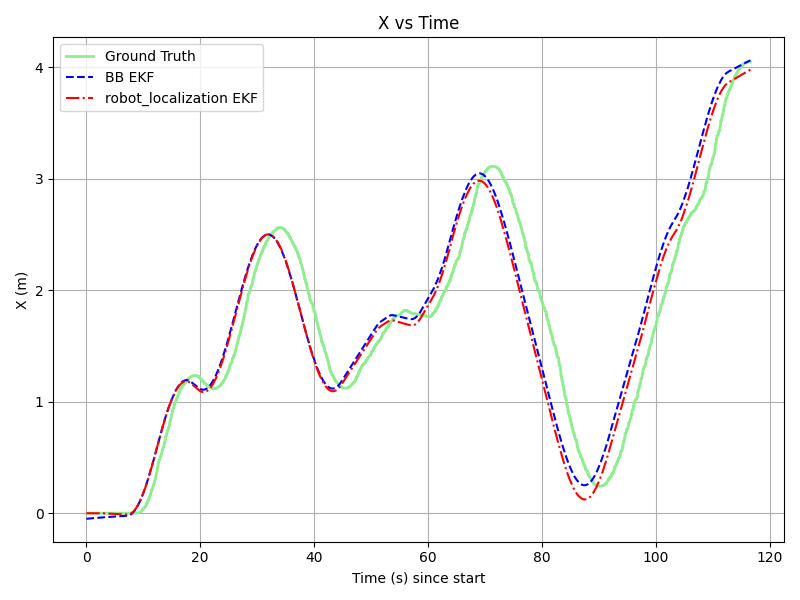
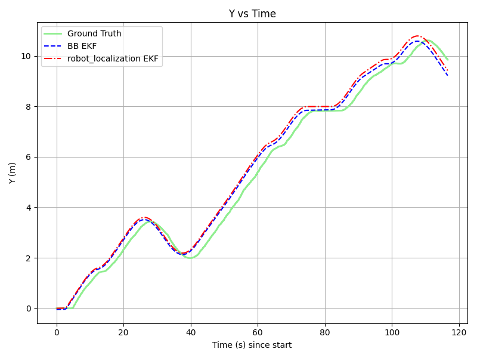
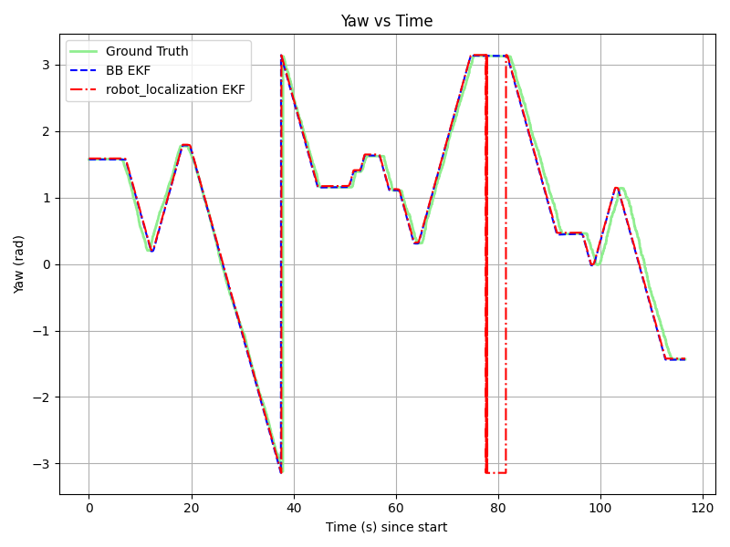
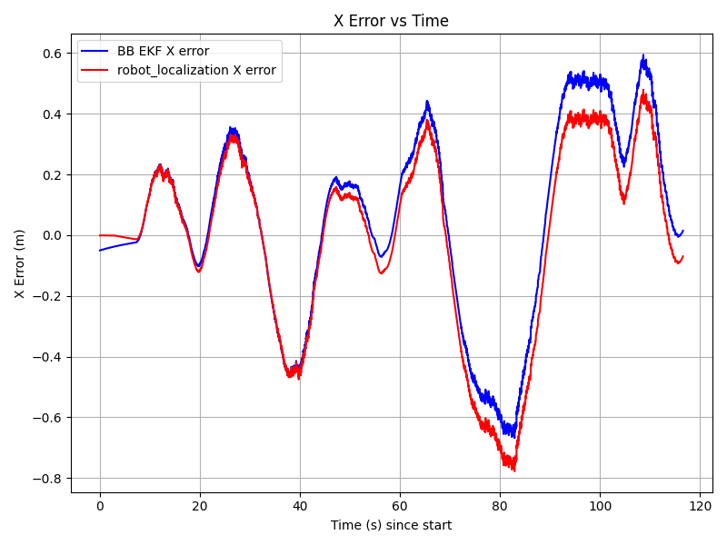
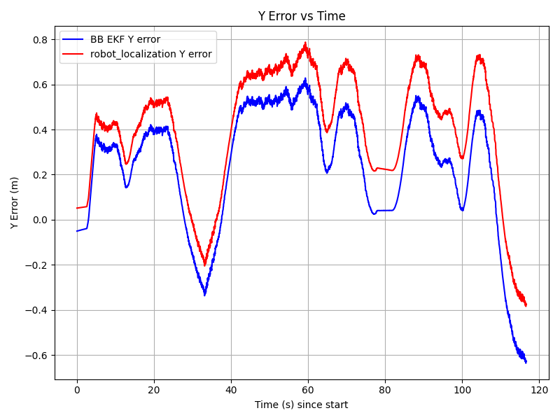
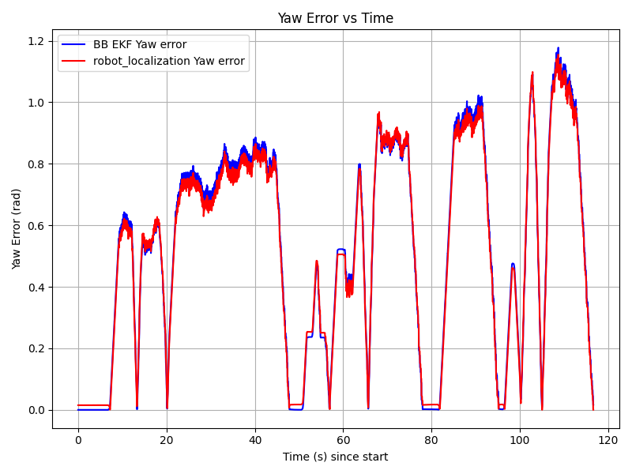

# Architecture and results

[Project](../README.md) · [Setup](SETUP.md) · [Thesis](thesis/report.pdf) · [Presentation](thesis/presentation.pdf)

## Perception

[`sign_detector_node.py`](../src/example/src/sign_detector_node.py) undistorts camera images and runs YOLOv5-Nano to detect eight traffic-sign classes. Color masks and shape checks identify contours within each detection. Known sign dimensions support Perspective-n-Point (PnP) pose estimation, with a pinhole depth estimate as a fallback.

The node converts positions to meters and transforms them into the vehicle frame, `chassis::link`. A temporal distance check filters inconsistent same-class observations. It publishes sign poses and labels for fusion, along with an annotated camera image.

| Topic | Data |
|---|---|
| `/automobile/image_raw` | Camera image |
| `/automobile/camera_info` | Camera calibration |
| `/sign_detector/sign_poses` | Sign positions in the vehicle frame |
| `/sign_detector/sign_labels` | Traffic-sign classes |
| `/automobile/image_annotated` | Detection overlay |

Dimitrios Asimakopoulos manually annotated approximately 3,000 traffic-sign images using LabelImg and trained YOLOv5-Nano for eight classes, using an 80/20 training–validation split and 640 × 640 model inputs. The repository includes a subset of 573 training and 144 validation images. The classes cover crosswalk, one-way, roundabout, no-entry, highway entry, parking, priority, and highway exit.

## Motion and sensor fusion

The [wheel encoder plugin](../src/plugins_pkgs/wheel_encoder_plugin/src/wheel_encoder_plugin.cpp) uses rear-wheel rotation, front-wheel steering, wheel radius, and wheelbase to compute Ackermann odometry. The vehicle model configures publication at 100 Hz. The simulated IMU supplies orientation at 10 Hz.

[`ekf_fusion_node.cpp`](../src/example/src/ekf_fusion_node.cpp) maintains five states:

`[x, y, yaw, speed, yaw rate]`

Wheel messages trigger motion prediction and velocity updates. IMU messages update heading with angle wrapping. For each visual observation, the filter searches the known landmark map for signs of the same class, selects the smallest squared Mahalanobis distance, and rejects matches above `5.99`. Accepted observations correct the predicted position through the EKF measurement model.

Ground truth initializes the pose once. The filter then publishes `/ekf/odom`, `/ekf/path`, and the `map → chassis::link` transform.

## Evaluation

[`ground_truth.py`](../src/example/src/ground_truth.py) converts Gazebo model states into the reference trajectory. [`characterize_sensors.py`](../src/example/src/characterize_sensors.py) compares wheel and IMU measurements with that reference to estimate noise.

[`evaluation.py`](../src/example/src/evaluation.py) aligns recorded paths within 0.05 seconds, calculates position and wrapped yaw errors, and exports metrics and plots. Position error is the Euclidean 3D distance, although the filter models planar motion.

The comparison executable, [`robot_localization.cpp`](../src/example/src/robot_localization.cpp), is a local encoder/IMU filter with deliberately inflated noise settings. It is distinct from the upstream ROS `robot_localization` package.

## Results

The representative simulation run in [Chapter 9 of the thesis](thesis/report.pdf#page=54) reports:

| Method | Position RMSE (m) | Yaw RMSE (rad) |
|---|---:|---:|
| BB EKF with sign updates | 0.4658 | 0.6129 |
| Local encoder/IMU comparison | 0.5505 | 0.6016 |

Position RMSE improved by approximately 15%, with slightly higher yaw error. Different covariance settings limit attribution of the improvement to visual updates alone.

*Trajectories aligned to their starting positions. Both estimates follow the route; their separation from ground truth shows position drift.*

### State tracking

<table>
  <tr>
    <td width="33%" align="center"> X position</td>
    <td width="33%" align="center"> Y position</td>
    <td width="33%" align="center"> Heading</td>
  </tr>
</table>

Green is ground truth, blue is BB EKF, and red is the local encoder/IMU comparison. Both filters track the overall motion, with visible position offsets. Heading largely overlaps; jumps near ±π are angle wrapping.

### Error over time

<table>
  <tr>
    <td width="33%" align="center"> X error</td>
    <td width="33%" align="center"> Y error</td>
    <td width="33%" align="center"> Heading error</td>
  </tr>
</table>

Closer to zero means a better estimate. BB EKF has smaller Y error for much of the run, but a larger final deviation. X error is mixed, and the heading errors nearly overlap: the improvement is mainly positional, rather than a consistent gain in every component.

The [repository CSV](../src/example/src/evaluation_plots/ekf_comparison_metrics.csv) contains a separate run, with position RMSE of 0.320 m for the vision-aided filter and 0.503 m for the comparison. Original rosbags and complete run configurations are not included.

## Design constraints

- **Known-map localization:** landmark coordinates are fixed, and ground truth supplies the initial pose.
- **Simulation assumptions:** the IMU provides idealized orientation, and the experiment does not model wheel slip.
- **Association timing:** sign poses and labels use separate buffers without timestamp synchronization.
- **Integration:** model class names must match the landmark map. The main launch starts two filters that broadcast the same TF child, so use a single transform publisher when running them together.

## Credits

Dimitrios Asimakopoulos developed the thesis localization work at the University of Crete, supervised by Prof. Panos Trahanias, with support from CVRL/FORTH and guidance from Michael Maravgakis. The BFMC simulator supplies the track, vehicle models, and simulator infrastructure. The detector uses [YOLOv5](../YOLOv5-traffic/yolov5), which retains its own license.
