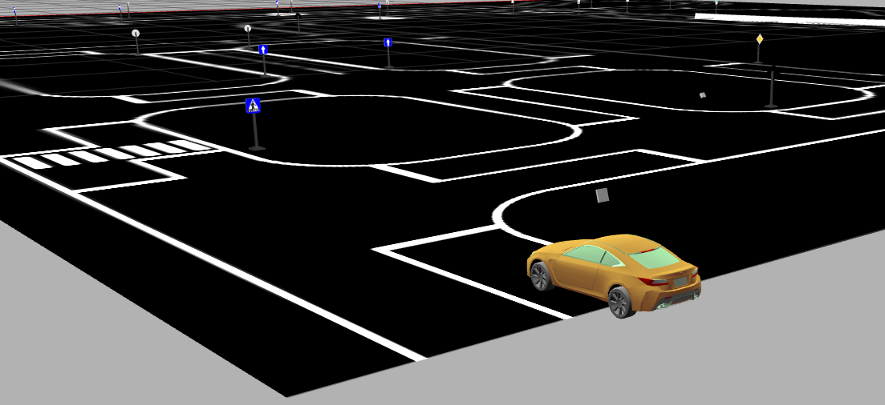
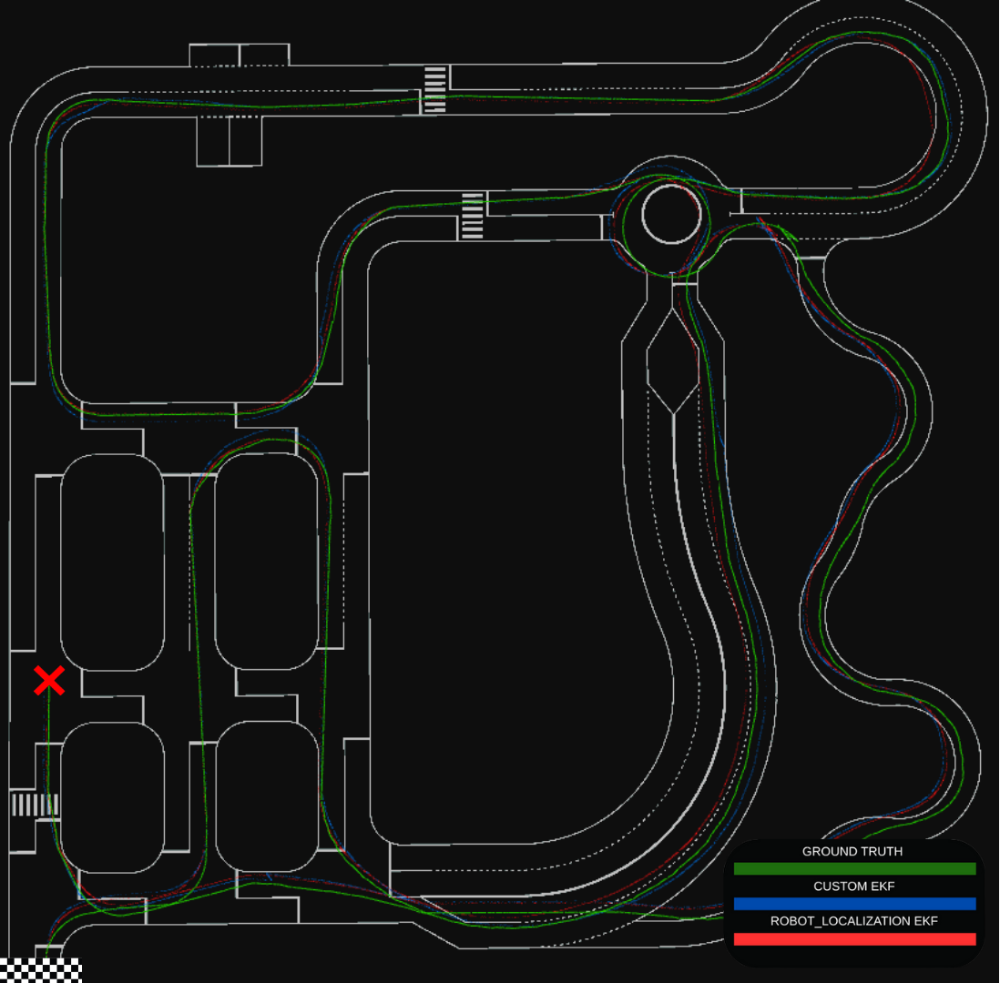

# Thesis and presentation

**Pose Estimation via Visual Inertial Wheel Odometry in Autonomous Vehicles**<br>
Dimitrios Asimakopoulos · Bachelor thesis · June 2025

Department of Computer Science, University of Crete, Heraklion, Greece. Supervised by **Prof. Panos Trahanias**, with resources provided by the **Computer Vision and Robotics Laboratory (CVRL), FORTH**. The acknowledgments also credit Michael Maravgakis for guidance.

## Original materials

| Document | Contents and provenance |
|---|---|
| [Original thesis PDF](report.pdf) | All 67 supplied pages, preserved byte-for-byte |
| [Presentation PDF](presentation.pdf) | All 25 supplied JPEG slides, in numerical order, embedded without image recompression |
| [Original presentation slide archive](presentation-slides.zip) | The supplied `thesis.zip`, preserved byte-for-byte |

The presentation PDF is assembled from the author's exported slide images. It contains raster slides, so its text is not selectable. The archive contains JPEGs only. Editable LaTeX and PowerPoint sources were not supplied, and no replacement report or reconstructed Overleaf package has been created.

The presentation title omits “Visual” from the report's longer title. Both original documents retain their supplied wording.

## Read by topic

PDF page numbers below count from the first page, including front matter.

| Topic | Thesis | Presentation |
|---|---|---|
| Motivation and contribution | [Chapter 1, PDF page 8](report.pdf#page=8) | [Slides 2–3](presentation.pdf#page=2) |
| YOLOv5-Nano, dataset, and geometric sign poses | [Chapter 4, PDF page 16](report.pdf#page=16) | [Slides 7–10](presentation.pdf#page=7) |
| Ackermann wheel odometry and simulated IMU | [Chapter 5, PDF page 25](report.pdf#page=25) | [Slides 11–12](presentation.pdf#page=11) |
| Five-state EKF and measurement models | [Chapter 6, PDF page 33](report.pdf#page=33) | [Slides 13–16](presentation.pdf#page=13) |
| Coordinate frames and monitoring | [Chapters 7–8, PDF page 42](report.pdf#page=42) | [Slides 17–20](presentation.pdf#page=17) |
| Evaluation and limitations | [Chapter 9, PDF page 52](report.pdf#page=52) | [Slides 21–24](presentation.pdf#page=21) |

## Presentation highlights

<table>
  <tr>
    <td width="50%"><a href="../images/thesis-vehicle.png"></a></td>
    <td width="50%"><a href="../images/thesis-rviz.png"></a></td>
  </tr>
  <tr>
    <td><sub>Thesis Figure 9: the simulated vehicle and sign-rich track.</sub></td>
    <td><sub>Thesis Figure 14: the original trajectory monitoring view.</sub></td>
  </tr>
</table>

These are historical simulation images from the supplied report. The [image provenance notes](../images/README.md) identify their exact sources.

## Rebuild the presentation PDF

From the repository root, with Python 3 and ReportLab installed:

```bash
python3 -m pip install reportlab
python3 docs/thesis/assemble_presentation.py
```

The [assembly script](assemble_presentation.py) reads the original archive directly, checks the 25 expected 1920 × 1080 slides, and creates a deterministic 16:9 PDF with slide bookmarks. It does not modify the report or source archive. To write a separate build:

```bash
python3 docs/thesis/assemble_presentation.py --output /tmp/thesis-presentation.pdf
```

Validation checks every embedded JPEG against its original archive entry and verifies slide order, page count, and page coverage.

## Relationship to the current code

The [README](../../README.md) introduces the thesis contribution. [Architecture and experimental evidence](../ARCHITECTURE.md) distinguish the report's representative run from the tracked CSV and explain current implementation details. The [setup guide](../SETUP.md) separates the verified software-only build from the historical full simulation workflow.

Braking Bad's BFMC semifinal placement is a team achievement supplied as project context. The thesis itself evaluates localization in Gazebo and lists physical vehicle tests as future work. Screenshots of the simulator and sensor illustrations should be interpreted within that scope.
